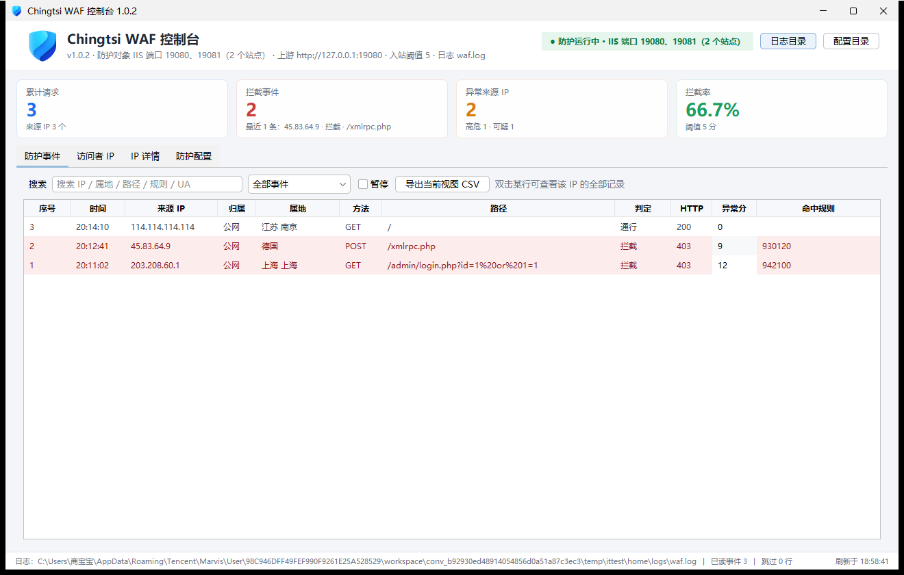

# Chingtsi WAF

**Lightweight reverse-proxy Web Application Firewall · Zero third-party runtime dependencies · Windows / IIS friendly**

Current version: **1.0.0.0** | [Architecture](docs/architecture.md) | [Rule Reference](docs/rules.md) | [Changelog](CHANGELOG.md) | [Third-Party Notices](THIRD-PARTY-NOTICES.md)

Chingtsi WAF is a reverse-proxy WAF written in pure JDK code: it does not inject into IIS and does not touch your site configuration. Instead, it runs as a standalone process listening on front-end ports, forwards requests to the original IIS sites, and performs rule matching, anomaly scoring, rate limiting, and auditing along the forwarding path. A graphical console is included, and protection can be provisioned automatically for the ports of the websites actually present on IIS.

```
                       ┌──────────────────────────┐
 Cloudflare Tunnel ──▶ │  Chingtsi WAF :8091      │ ──▶ IIS site 127.0.0.1:80
   Browser / attacker  │  rules · scoring · limit │
                       └──────────────────────────┘
                                  │
                           GUI console / logs
```

---

## Features

| Capability | Description |
| --- | --- |
| Reverse-proxy protection | Built on `com.sun.net.httpserver` + `java.net.http.HttpClient`, using only modules shipped with the JDK |
| Rule engine | A lean implementation compatible with ModSecurity `SecRule` syntax, supporting `@rx @pm @contains @streq @eq @beginsWith @endsWith @gt @ge` |
| Anomaly scoring | OWASP CRS–style scoring model: requests are blocked once the accumulated score reaches the threshold, avoiding false positives from a single rule |
| Built-in rule set | 45 rules covering protocol compliance, SQL injection, XSS, RCE/LFI, and sensitive-path probing |
| Automatic IIS protection | Reads `applicationHost.config` automatically, derives a front-end port for every IIS site's HTTP port, and keeps following site additions and removals |
| Visitor profiling | Records visitor IP, matched rules, request line, and User-Agent, plus **offline IP geolocation** (intranet/loopback detected automatically, no network access required) |
| IP lists | Allowlist and blocklist with CIDR and wildcard support; requests from allowlisted sources skip all inspection |
| CC protection | Sliding-window rate limiting plus automatic banning (default: 60s / 600 requests / 300s ban) |
| Hot rule reloading | Compares the rule directory fingerprint every 5 seconds and swaps rules atomically when it changes, with no restart |
| Graphical console | Swing + FlatLaf, with four pages — Protection Events / Visitor IPs / IP Details / Protection Settings — supporting filtering and CSV export |
| Audit log | JSON Lines, ready to feed into ELK / Loki |
| Trimmed runtime | The installer embeds a stripped runtime built with `jlink` (including `java.desktop`), so the target machine needs no preinstalled Java |

## Quick Start

**Requirements**: JDK 17+ (to compile), Windows / Linux / macOS.

```bat
git clone https://github.com/QingciJiang/Chingtsi-WAF.git
cd Chingtsi-WAF
build.bat            :: Linux/macOS: ./build.sh
run-ui.bat           :: graphical console
run-console.bat      :: console mode (for debugging)
```

Build output: `dist\chingtsi-waf.jar`. Before the first run, prepare the offline IP database (optional; when missing, the location column shows `-`):

```bat
:: Download ip2region v1's ip2region.db into the data\ directory
mkdir data
curl -L -o data\ip2region.db https://raw.githubusercontent.com/lionsoul2014/ip2region/master/data/ip2region.db
```

The default listener is `0.0.0.0:8091` and the upstream is `http://127.0.0.1:80`. Point Cloudflare Tunnel / Nginx at port 8091 to put the WAF in front of your site.

### Minimal Build-Free Run

```bash
javac -encoding UTF-8 -d build/classes $(find src -name '*.java')
cp src/com/chingtsi/waf/ui/*.png build/classes/com/chingtsi/waf/ui/
mkdir -p dist
jar --create --file dist/chingtsi-waf.jar --main-class com.chingtsi.waf.WafMain -C build/classes .
java -Dwaf.home="$PWD" -cp "dist/chingtsi-waf.jar:lib/flatlaf.jar" com.chingtsi.waf.ui.DashboardMain
```

## Configuration

All configuration lives in `conf/waf.properties`; changes take effect after restarting the process (except rule files, which are hot-reloaded).

| Key | Default | Description |
| --- | --- | --- |
| `listen.host` / `listen.port` | `0.0.0.0` / `8091` | Listen address and port; in automatic mode the lowest IIS site reuses this port |
| `upstream.base` | `http://127.0.0.1:80` | Fallback upstream (in automatic mode, specified per site port) |
| `upstream.timeout.ms` | `30000` | Upstream timeout |
| `server.name` | `Chingtsi-WAF` | Server header written back to clients |
| `max.body.bytes` | `10485760` | Maximum request body size |
| `allow.methods` | `GET,POST,HEAD,OPTIONS,PUT,DELETE,PATCH` | Allowed HTTP methods |
| `threshold.inbound` | `5` | Inbound anomaly score threshold |
| `rate.window.seconds` / `rate.limit` / `rate.ban.seconds` | `60` / `600` / `300` | CC protection parameters |
| `ip.whitelist` / `ip.blacklist` | `conf/ip-*.txt` | Paths to the IP list files |
| `trust.cloudflare.ip` | `true` | Whether to trust `CF-Connecting-IP` |
| `log.file` / `log.json` | `logs/waf.log` / `true` | Audit log location and format |
| `log.flush.every` | `1` | Number of records per forced flush; `1` = flush every record, values above 1 also get a 1-second fallback flush thread |
| `iis.auto` | `true` | Automatically read the IIS configuration and protect per site port |
| `iis.config.file` | empty | Custom path to `applicationHost.config` |
| `iis.front.map` | empty | Explicit port mapping, e.g. `80:8091,8080:16080` |
| `iis.refresh.seconds` | `20` | IIS configuration refresh interval (minimum 5) |

## Automatic IIS Protection

IIS already occupies ports such as 80/8080, which the WAF cannot and should not seize. It therefore derives a front-end port for each site port:

1. An explicit `iis.front.map` mapping takes precedence;
2. When not configured: **the lowest site port reuses `listen.port`**, and the others are assigned `site port + 8000` in ascending order, with `+1000` applied on conflict;
3. A derived port is never equal to an IIS site port.

Site additions and removals take effect within one refresh cycle. The status badge at the top of the console shows the actual protected targets, for example:

```
● Protection running · IIS ports 80, 8080 (2 sites)
```

> When newly added sites use derived ports, those ports must be allowed through the firewall; on machines without IIS installed, the WAF falls back to listening on the fixed `listen.port`.

## Writing Rules

```
# Fields: REQUEST_URI / ARGS / REQUEST_BODY / REQUEST_HEADERS:User-Agent / REMOTE_ADDR ...
#         Separate multiple fields with |; write single/double quotes inside arguments as \x27 / \x22
SecRule ARGS|REQUEST_URI|REQUEST_BODY "@rx (?:\bunion\b[\s/**/]+\bselect\b)" \
  "id:2001,score:5,msg:'SQL injection: union select',action:block"
```

- `score` is added to the request's total score; reaching `threshold.inbound` triggers a block;
- `action` currently supports `block` (block the request and return a 403 block page) and `pass` (log only);
- Rule IDs must be unique; rules are loaded in filename order.

## Graphical Console

| Page | Contents |
| --- | --- |
| Protection Events | Time, source IP, **location**, method, URI, matched rule, and action taken, with keyword/location filtering and CSV export |
| Visitor IPs | Per-IP aggregated request count, block count, hit count, last access time, and location |
| IP Details | Request details and rule-hit distribution for a single IP, with one-click add to blocklist/allowlist |
| Protection Settings | Listener status, `site port → front-end port` per site, IIS configuration source, geolocation database status, rule and rate-limit parameters |



## Building the Windows Installer

Requires [Inno Setup 6](https://jrsoftware.org/isinfo.php) and [WinSW](https://github.com/winsw/winsw).

```bat
build.bat
installer\build-installer.bat
```

The script invokes `jlink` to generate a trimmed runtime (`java.base/java.logging/java.net.http/jdk.httpserver/java.desktop`), assembles `dist\stage`, and then compiles `dist\Chingtsi-WAF-Setup-1.0.0.0-x64.exe` with ISCC. Installing or upgrading preserves `conf`, `rules`, and `logs`.

If WinSW is placed in `tools\`, the script detects it automatically; see [tools/README.md](tools/README.md) for details. For the packaging internals and the pitfalls encountered, see [docs/architecture.md](docs/architecture.md).

## Directory Layout

```
src/com/chingtsi/waf/
├─ WafMain.java            Entry point: wires config, listeners, graceful shutdown
├─ WafConfig.java          Hand-rolled properties parser (preserves path backslashes)
├─ ProxyHandler.java       Reverse proxy + inspection chain
├─ RuleEngine.java         Variable extraction, operator matching, scoring
├─ Rule.java               Rule model and SecRule parsing
├─ ListenerManager.java    Multi-port listener assembly and status aggregation
├─ RateLimiter.java        Sliding-window rate limiting and banning
├─ IpSet.java              CIDR / wildcard IP lists
├─ AccessLog.java          JSON Lines audit log
├─ BlockPage.java          Block page
├─ iis/                    IIS config parsing, site snapshots, port planning, scheduled refresh
├─ geo/                    Offline IP geolocation (ip2region v1, little-endian index)
└─ ui/                     Swing console (DashboardMain / UiKit / event model)
conf/  Configuration and IP lists
rules/ Rule sets (protocol / SQLi / XSS / RCE-LFI / sensitive paths / custom)
data/  Offline geolocation database (not committed, see data/README.md)
lib/   FlatLaf 3.5.4 (Apache-2.0)
installer/ Inno Setup script and packaging scripts
docs/  Architecture, rule reference, screenshots
tools/ Packaging helpers (WinSW, not distributed with the repository)
```

## Known Limitations

- Only HTTP is protected; HTTPS is not decrypted. TLS should be terminated by Cloudflare / Nginx.
- The rule engine covers common operators and is not a full ModSecurity implementation; complex `chain`, `ctl`, and `SecAction` are not implemented.
- Outbound response body inspection is reserved (`threshold.outbound` is not yet effective).
- Console data comes from local log files; multi-instance deployments require you to aggregate them yourself.

## License

The source code is released under the **Apache License 2.0**, Copyright (c) 2026 Chingtsi Studio.
See [THIRD-PARTY-NOTICES.md](THIRD-PARTY-NOTICES.md) for third-party components and licenses.

> Chingtsi WAF's rule syntax draws on the publicly documented design ideas of ModSecurity and OWASP CRS. It is an independent implementation and contains no copied source code from those projects.
