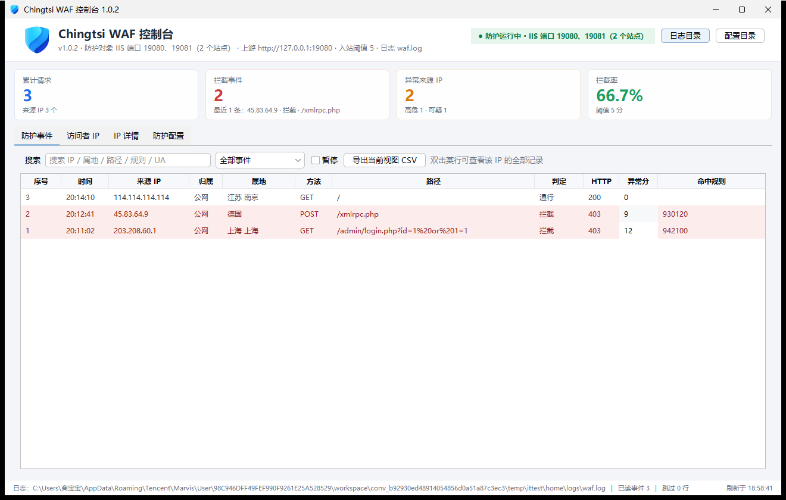

# Chingtsi WAF
[English](README.en.md) | 简体中文

**轻量级反向代理型 Web 应用防火墙 · 零第三方运行时依赖 · Windows / IIS 友好**

当前版本：**1.0.0.0** ｜ [架构说明](docs/architecture.md) ｜ [规则参考](docs/rules.md) ｜ [更新日志](CHANGELOG.md) ｜ [第三方声明](THIRD-PARTY-NOTICES.md)

Chingtsi WAF 是一个用纯 JDK 编写的反向代理 WAF：它不注入 IIS、不改动站点配置，而是作为独立进程监听前置端口，把请求转发给原来的 IIS 站点，在转发链路上完成规则匹配、异常评分、频率限制与审计。自带图形控制台，可按 IIS 上真实存在的网站端口自动布置防护。

```
                       ┌──────────────────────────┐
 Cloudflare Tunnel ──▶ │  Chingtsi WAF :8091      │ ──▶ IIS 站点 127.0.0.1:80
   浏览器 / 攻击者      │  规则引擎 · 评分 · 限流    │
                       └──────────────────────────┘
                                  │
                          图形控制台 / 日志
```

---

## 特性

| 能力 | 说明 |
| --- | --- |
| 反向代理防护 | 基于 `com.sun.net.httpserver` + `java.net.http.HttpClient`，仅用 JDK 自带模块 |
| 规则引擎 | 兼容 ModSecurity `SecRule` 写法的精简实现，支持 `@rx @pm @contains @streq @eq @beginsWith @endsWith @gt @ge` |
| 异常评分 | 仿 OWASP CRS 计分模型，累计分数达阈值即拦截，避免单条规则误杀 |
| 内置规则集 | 45 条规则，覆盖协议合规、SQL 注入、XSS、RCE/LFI、敏感路径探测 |
| IIS 自动防护 | 自动读取 `applicationHost.config`，为每个 IIS 网站的 HTTP 端口派生前置端口并持续跟随站点增删 |
| 访问者画像 | 记录访问 IP、命中规则、请求行、UA，附带**离线 IP 属地**（内网/本机自动识别，无需联网） |
| IP 名单 | 黑白名单，支持 CIDR 与通配，白名单来源跳过全部检测 |
| CC 防护 | 滑动窗口限速 + 自动封禁（默认 60s / 600 次 / 封 300s） |
| 规则热加载 | 每 5 秒比对规则目录指纹，变化后原子替换，无需重启 |
| 图形控制台 | Swing + FlatLaf，防护事件 / 访问者 IP / IP 详情 / 防护配置四页，支持筛选与 CSV 导出 |
| 审计日志 | JSON Lines，可直接喂给 ELK / Loki |
| 精简运行时 | 安装包用 `jlink` 内嵌裁剪运行时（含 `java.desktop`），目标机不需要预装 Java |

## 快速开始

**要求**：JDK 17+（编译用），Windows / Linux / macOS 均可。

```bat
git clone https://github.com/QingciJiang/Chingtsi-WAF.git
cd ChingtsiWAF
build.bat            :: Linux/macOS: ./build.sh
run-ui.bat           :: 图形控制台
run-console.bat      :: 控制台模式（调试用）
```

构建产物：`dist\chingtsi-waf.jar`。首次运行前准备离线 IP 库（可选，缺失时属地列显示 `-`）：

```bat
:: 下载 ip2region v1 的 ip2region.db 放到 data\ 目录
mkdir data
curl -L -o data\ip2region.db https://raw.githubusercontent.com/lionsoul2014/ip2region/master/data/ip2region.db
```

默认监听 `0.0.0.0:8091`，上游 `http://127.0.0.1:80`。把 Cloudflare Tunnel / Nginx 指向 8091 即可前置防护。

### 无构建工具的最小运行方式

```bash
javac -encoding UTF-8 -d build/classes $(find src -name '*.java')
cp src/com/chingtsi/waf/ui/*.png build/classes/com/chingtsi/waf/ui/
mkdir -p dist
jar --create --file dist/chingtsi-waf.jar --main-class com.chingtsi.waf.WafMain -C build/classes .
java -Dwaf.home="$PWD" -cp "dist/chingtsi-waf.jar:lib/flatlaf.jar" com.chingtsi.waf.ui.DashboardMain
```

## 配置

全部配置在 `conf/waf.properties`，改完重启进程生效（规则文件除外，支持热加载）。

| 键 | 默认 | 说明 |
| --- | --- | --- |
| `listen.host` / `listen.port` | `0.0.0.0` / `8091` | 监听地址与端口；自动模式下最小 IIS 站点沿用此端口 |
| `upstream.base` | `http://127.0.0.1:80` | 兜底上游（自动模式下按站点端口逐个指定） |
| `upstream.timeout.ms` | `30000` | 上游超时 |
| `server.name` | `Chingtsi-WAF` | 对外回写的 Server 头 |
| `max.body.bytes` | `10485760` | 请求体上限 |
| `allow.methods` | `GET,POST,HEAD,OPTIONS,PUT,DELETE,PATCH` | 允许的方法 |
| `threshold.inbound` | `5` | 入站异常分阈值 |
| `rate.window.seconds` / `rate.limit` / `rate.ban.seconds` | `60` / `600` / `300` | CC 防护参数 |
| `ip.whitelist` / `ip.blacklist` | `conf/ip-*.txt` | 名单文件路径 |
| `trust.cloudflare.ip` | `true` | 是否采信 `CF-Connecting-IP` |
| `log.file` / `log.json` | `logs/waf.log` / `true` | 审计日志位置与格式 |
| `log.flush.every` | `1` | 每写多少条强制刷盘；`1` = 每条立即落盘，大于 1 时另有 1 秒兜底刷盘线程 |
| `iis.auto` | `true` | 自动读取 IIS 配置并按站点端口防护 |
| `iis.config.file` | 空 | 自定义 `applicationHost.config` 路径 |
| `iis.front.map` | 空 | 显式端口映射，如 `80:8091,8080:16080` |
| `iis.refresh.seconds` | `20` | IIS 配置刷新间隔（最小 5） |

## IIS 自动防护

IIS 已经占用了 80/8080 等端口，WAF 无法也不应抢占，因此会为每个站点端口派生一个前置端口：

1. `iis.front.map` 显式映射优先；
2. 未配置时：**最小的站点端口沿用 `listen.port`**，其余按 `站点端口 + 8000` 递增，冲突再 `+1000`；
3. 派生端口永不等于 IIS 站点端口。

站点增删在一个刷新周期内自动生效。控制台顶部状态徽标直接显示真实防护对象，例如：

```
● 防护运行中 · IIS 端口 80、8080（2 个站点）
```

> 新增站点使用派生端口时，需在防火墙放行对应端口；未安装 IIS 的机器自动回落为固定监听 `listen.port`。

## 规则写法

```
# 字段：REQUEST_URI / ARGS / REQUEST_BODY / REQUEST_HEADERS:User-Agent / REMOTE_ADDR ...
#       多个字段用 | 分隔；参数内单双引号写作 \x27 / \x22
SecRule ARGS|REQUEST_URI|REQUEST_BODY "@rx (?:\bunion\b[\s/**/]+\bselect\b)" \
  "id:2001,score:5,msg:'SQL 注入：union select',action:block"
```

- `score` 累加到请求总分，达到 `threshold.inbound` 即拦截；
- `action` 目前支持 `block`（阻断并返回 403 拦截页）与 `pass`（仅记录）；
- 规则编号需唯一，按文件名顺序加载。

## 图形控制台

| 页面 | 内容 |
| --- | --- |
| 防护事件 | 时间、来源 IP、**属地**、方法、URI、命中规则、处置结果，支持关键字/属地过滤与 CSV 导出 |
| 访问者 IP | 按 IP 聚合的请求量、拦截量、命中次数、末次访问时间与属地 |
| IP 详情 | 单 IP 的请求明细、规则命中分布，支持一键加入黑名单/白名单 |
| 防护配置 | 监听状态、逐站点 `站点端口 → 前置端口`、IIS 配置来源、地理库状态、规则与限流参数 |



## 打包 Windows 安装包

需要 [Inno Setup 6](https://jrsoftware.org/isinfo.php) 与 [WinSW](https://github.com/winsw/winsw)。

```bat
build.bat
installer\build-installer.bat
```

脚本会调用 `jlink` 生成裁剪运行时（`java.base/java.logging/java.net.http/jdk.httpserver/java.desktop`）、组装 `dist\stage`、再用 ISCC 编译出 `dist\Chingtsi-WAF-Setup-1.0.0.0-x64.exe`。安装/升级会保留 `conf`、`rules`、`logs`。

WinSW 放入 `tools\` 后脚本自动识别，详见 [tools/README.md](tools/README.md)；打包原理与踩坑记录见 [docs/architecture.md](docs/architecture.md)。

## 目录结构

```
src/com/chingtsi/waf/
├─ WafMain.java            入口：装配配置、监听、优雅退出
├─ WafConfig.java          自研 properties 解析（保留路径反斜杠）
├─ ProxyHandler.java       反向代理 + 检测链
├─ RuleEngine.java         变量取值、操作符匹配、评分判定
├─ Rule.java               规则模型与 SecRule 解析
├─ ListenerManager.java    多端口监听装配与状态汇总
├─ RateLimiter.java        滑动窗口限流与封禁
├─ IpSet.java              CIDR / 通配名单
├─ AccessLog.java          JSON Lines 审计日志
├─ BlockPage.java          拦截页
├─ iis/                    IIS 配置解析、站点快照、端口规划、定时刷新
├─ geo/                    离线 IP 属地定位（ip2region v1，小端序索引）
└─ ui/                     Swing 控制台（DashboardMain / UiKit / 事件模型）
conf/  配置与 IP 名单
rules/ 规则集（协议 / SQLi / XSS / RCE-LFI / 敏感路径 / 自定义）
data/  离线地理库（不入库，见 data/README.md）
lib/   FlatLaf 3.5.4（Apache-2.0）
installer/ Inno Setup 脚本与打包脚本
docs/  架构说明、规则参考、截图
tools/ 打包辅助（WinSW，不随仓库分发）
```

## 已知限制

- 只防护 HTTP，不解密 HTTPS；TLS 建议交给 Cloudflare / Nginx 终止。
- 规则引擎覆盖常用操作符，不是 ModSecurity 全量实现；复杂 `chain`、`ctl`、`SecAction` 未实现。
- 出站响应体检测为预留项（`threshold.outbound` 暂不生效）。
- 控制台数据来自本地日志文件，多实例部署需自行汇总。

## 许可

源码以 **Apache License 2.0** 发布，Copyright (c) 2026 Chingtsi Studio。
第三方组件与许可见 [THIRD-PARTY-NOTICES.md](THIRD-PARTY-NOTICES.md)。

> Chingtsi WAF 的规则写法参考 ModSecurity 与 OWASP CRS 的公开设计思路，为独立实现，未复制其源码。
